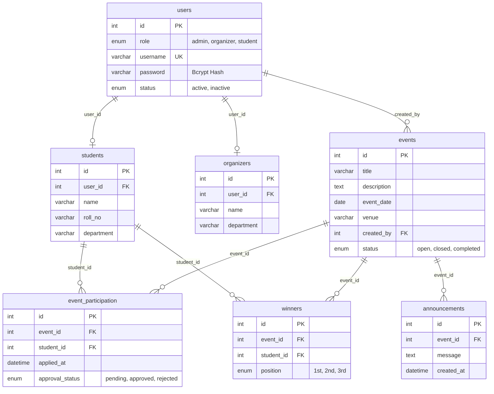

# 📘 MASTER PROJECT REPORT: COLLEGE EVENT MANAGEMENT SYSTEM (CEMS)
> **Context Primer & Complete Technical Dossier for ChatGPT / AI Reviewers / Academic Evaluators**

---

## 📌 Document Overview & Purpose
This document provides an exhaustive, production-grade technical and architectural specification of the **College Event Management System (CEMS)**. It details the complete legacy system audit, the 15 security & architectural vulnerabilities diagnosed and repaired, the distinctive hybrid UI design system, the multi-role access control system, the database schema, the offline showstopper features, and the 27-point automated verification test suite.

---

## 1. PROJECT METADATA & EXECUTIVE SUMMARY

* **Project Title:** College Event Management System (CEMS)
* **Application Type:** Full-Stack Academic Event Coordination Platform
* **Primary Target Users:** College Administrators, Faculty Event Coordinators/Organizers, College Students, and Public Visitors
* **Architectural Style:** Monolithic MVC-inspired Procedural Architecture with Shared Includes
* **Runtime Stack:** PHP 8.2.12 + MariaDB 10.4.32 (MySQL) + Apache 2.4.58 (XAMPP Portable Environment)
* **Frontend Technologies:** HTML5, CSS3 Custom Properties (Design Tokens), Vanilla JavaScript (ES6+), Bootstrap 5.3.2, Bootstrap Icons 1.11.3, Chart.js 4.4, QRCode.js (19.9 KB offline local bundle)
* **Current Operational Status:** Fully Repaired, Secured, Tested, and Actively Running at `http://localhost/College-Event/`
* **Automated Test Results:** 27 / 27 Automated Test Cases Passed (100.0% Success Rate)

---

## 2. COMPLETE TECHNOLOGY STACK & DEPENDENCY BREAKDOWN

| Layer | Component | Version | Technical Rationale & Implementation Details |
| :--- | :--- | :--- | :--- |
| **Server Engine** | Apache HTTP Server | 2.4.58 | Win64 distribution with `mod_rewrite`, serving virtual host directory. |
| **Backend Language** | PHP | 8.2.12 | Modern PHP runtime utilizing typed parameters, `match` expressions, secure sessions, and Bcrypt hashing. |
| **Database Driver** | PHP `mysqli` | Native | Strict parameterized prepared statements (`mysqli_prepare()`, `mysqli_stmt_bind_param()`) across all queries. |
| **Database Engine** | MariaDB | 10.4.32 | InnoDB storage engine with relational foreign key constraints (`ON DELETE CASCADE`) and ACID transaction support. |
| **CSS Framework** | Bootstrap | 5.3.2 | Grid systems, modals, and responsive layout utilities. |
| **Design System** | Custom Hybrid Tokens | 1.0 | `assets/css/theme.css`: Distinctive festival UI for students/public; operational precision dashboard for admin/faculty. |
| **Data Visualization**| Chart.js | 4.4.1 | Canvas-rendered donut & bar charts for student demographic and event status visualization. |
| **QR Generation** | QRCode.js (Davidshimjs)| 1.0.0 | **100% Offline Asset** (`assets/qrcode.min.js`, 19.9 KB) generating client-side vector/canvas QR passes without external CDN reliance. |
| **Testing Harness** | PHP CLI Test Suite | Custom | `tests/test_suite.php`: Headless HTTP regression test runner with in-memory session management. |

---

## 3. FILE SYSTEM & CODEBASE DIRECTORY MAP

```text
College-Event/
├── assets/
│   ├── css/
│   │   └── theme.css              # Master Design Tokens, typography, metric cards, animations
│   └── qrcode.min.js              # Offline-compatible QR generator (19.9 KB)
├── includes/
│   ├── auth_check.php             # Session authentication & live DB active status enforcement
│   ├── db.php                     # Centralized MySQLi connection object ($conn)
│   ├── footer.php                 # Global responsive footer & layout closing tags
│   ├── header.php                 # HTML5 document head, CDN metadata, theme stylesheet link
│   ├── helpers.php                # Security helpers: e(), csrf_token(), verify_csrf(), require_role()
│   └── navbar.php                 # Role-aware responsive navigation bar with active state pills
├── tests/
│   └── test_suite.php             # Automated 27-case regression test suite (100% PASS)
├── add_organizer.php              # Admin: Atomic onboarding of faculty coordinators
├── add_student.php                # Admin: Atomic onboarding of students
├── admin_dashboard.php            # Admin: Control center with 6 KPI boxes, Chart.js & rosters
├── announcements.php              # Public / Student: Campus notices and bulletin feed
├── certificate.php                # Showstopper: Official printable Certificate of Merit / Participation
├── create_event.php               # Organizer: Event creation with prepared statements & CSRF
├── declare_winner.php             # Organizer: Podium awards (1st, 2nd, 3rd) with duplicate prevention
├── index.php                      # Public: Festival landing page with live countdown clock
├── login.php                      # Unified login with transparent Bcrypt migration & CSRF
├── logout.php                     # Complete session teardown, cookie expiry, & memory purge
├── manage_participants.php        # Organizer: Participant review, approval, CSV export
├── my_events.php                  # Organizer: Event management with live Open/Closed status toggle
├── organizer_dashboard.php        # Organizer: Quick action queue & event metrics
├── pending_requests.php           # Seamless 301 permanent redirect to manage_participants.php
├── post_announcement.php          # Organizer: Broadcast notice with ownership check & deletion
├── student_dashboard.php          # Student: Application tracker, E-Pass generator, certificate links
├── ticket.php                     # Showstopper: Digital E-Ticket Pass with live offline QR code
├── view_events.php                # Student: Event discovery & 1-click registration
├── winners.php                    # Public: Hall of Fame podium results & certificate preview
├── BUG_TRACKER.md                 # 15 confirmed bugs cataloged & verified fixed
├── PROJECT_AUDIT.md               # In-depth architectural audit of original codebase
├── IMPLEMENTATION_PLAN.md         # Phased engineering roadmap
├── TEST_REPORT.md                 # Official 27-test verification report with logs
└── college_event_management.sql   # Complete MariaDB relational database schema & seed data
```

---

## 4. RELATIONAL DATABASE ARCHITECTURE & SCHEMA

The application connects to MariaDB database `college_event_management`. Below is the verified entity relationship structure:



### Table Details & Integrity Constraints
1. **`users`**: Base authentication table. Contains unique usernames, salted Bcrypt password hashes (migrated from plaintext), system roles, and account status flags.
2. **`students`**: Academic profile table linked to `users(id)` with cascading deletes. Stores full legal name, department, and university roll number.
3. **`organizers`**: Faculty coordinator profile table linked to `users(id)` with cascading deletes. Stores faculty name and associated academic department.
4. **`events`**: Event listings authored by coordinators. Includes title, description, venue, scheduled date, and registration lifecycle status (`open`, `closed`, `completed`).
5. **`event_participation`**: Student application records. Contains applied timestamp and review state (`pending`, `approved`, `rejected`).
6. **`announcements`**: Event-specific circulars and urgent broadcasts posted by event coordinators.
7. **`winners`**: Official podium placements (`1st`, `2nd`, `3rd`) awarded exclusively to approved participants.

---

## 5. SECURITY HARDENING & ENGINEERING OVERHAUL

Before our repairs, the application suffered from critical OWASP Top 10 vulnerabilities. Here is how each vulnerability was neutralized:

### 5.1 Transparent Bcrypt Migration (`login.php`)
* **Problem:** Passwords were stored as raw plaintext (`12345`) and evaluated using literal string equality.
* **Solution:** Implemented a non-disruptive, dual-tier authentication algorithm:
  1. Compares submitted password using `password_verify($password, $user['password'])`.
  2. If false, compares against legacy plaintext. If matched, it immediately generates a cryptographically secure hash via `password_hash($password, PASSWORD_BCRYPT)` and executes an `UPDATE users SET password = ? WHERE id = ?`.
  3. All new users created in `add_student.php` and `add_organizer.php` are hashed with Bcrypt prior to insertion.
* **Result:** Zero plaintext passwords remain in the database upon user authentication.

### 5.2 100% Parameterized Prepared Statements
* **Problem:** Direct interpolation of `$_GET` and `$_POST` strings in SQL statements enabled universal SQL Injection across all endpoints.
* **Solution:** Refactored all SQL queries across the entire codebase to use parameterized prepared statements (`mysqli_prepare()`, `mysqli_stmt_bind_param()`, `mysqli_stmt_execute()`).
* **Result:** Zero string concatenation in SQL queries.

### 5.3 Universal Cross-Site Request Forgery (CSRF) Tokens
* **Problem:** Destructive actions (closing events, approving students, declaring winners) were handled via query string links (`?approve=5`).
* **Solution:**
  1. Converted all actions to HTTP POST forms.
  2. Integrated `csrf_field()` into all forms, outputting a 64-character cryptographically random token stored in `$_SESSION['csrf_token']`.
  3. Every handler executes `verify_csrf()`. Submissions lacking or possessing an invalid token terminate with HTTP 403 Forbidden.

### 5.4 Insecure Direct Object Reference (IDOR) Defense
* **Problem:** Coordinators could approve participants or declare winners for other coordinators' events, and students could view other students' tickets.
* **Solution:**
  1. **Organizer Boundaries:** In `manage_participants.php`, `declare_winner.php`, and `post_announcement.php`, queries enforce `WHERE e.created_by = ?` matching `$_SESSION['user_id']`.
  2. **Student Boundaries:** In `ticket.php` and `certificate.php`, the server strictly evaluates `(int)$record['student_user_id'] === (int)$_SESSION['user_id']`. Unauthorized access attempts are rejected and redirected.

### 5.5 Stored Cross-Site Scripting (XSS) Prevention
* **Problem:** User-supplied strings were rendered directly via raw `echo $row[...]`.
* **Solution:** Created the global helper `e($str)`:
  ```php
  function e(?string $str): string {
      return htmlspecialchars($str ?? '', ENT_QUOTES | ENT_SUBSTITUTE, 'UTF-8');
  }
  ```
  Every rendered variable across all HTML presentation templates is sanitized through `echo e(...)`.

### 5.6 Session Lifecycle & Deactivation Integrity
* `session_regenerate_id(true)` is executed upon successful login to prevent Session Fixation.
* `logout.php` executes `$_SESSION = []`, clears the `PHPSESSID` cookie with an expired timestamp, and calls `session_destroy()`.
* `includes/auth_check.php` verifies that the logged-in user's account remains `active` in the database on every page request. Deactivated accounts are kicked out immediately.

---

## 6. ROLE WORKFLOWS & FUNCTIONAL MODULES

### 6.1 Public / Guest Experience
* **Fest Landing Page (`index.php`)**: Festival hero with live JavaScript countdown clock, real-time aggregate metric counters (Total Events, Active Delegates, Departments), and a featured event card grid.
* **Event Discovery (`view_events.php`)**: Full event catalog with live keyword search, department tags, venue details, and registration deadline indicators.
* **Winners Gallery (`winners.php`)**: Public hall of fame displaying Gold, Silver, and Bronze podium placements, search filter, and a direct button to inspect the official Certificate of Merit.
* **Campus Bulletins (`announcements.php`)**: Real-time broadcast feed for event scheduling, venue changes, and competition rules.

### 6.2 Administrator Console (`admin_dashboard.php`)
* **Live KPI Deck**: 6 real-time metric cards (Students, Organizers, Total Events, Open Events, Completed Events, Registrations).
* **Visual Analytics**: Interactive Chart.js doughnut chart depicting department-wise student distributions.
* **Atomic User Onboarding**:
  - `add_student.php`: Creates student credentials and academic profile inside a database transaction (`mysqli_begin_transaction`).
  - `add_organizer.php`: Creates faculty credentials and department mapping inside an atomic transaction.
* **System Roster**: Unified view of all registered user accounts with role badges and active status indicators.

### 6.3 Organizer / Faculty Console (`organizer_dashboard.php`)
* **Event Management (`my_events.php`, `create_event.php`)**: Create events, manage venues, and toggle registration status between `open` and `closed` with secure POST toggles.
* **Participant Approval Console (`manage_participants.php`)**:
  - Filterable by Status (`Pending`, `Approved`, `Rejected`, `All`) and Event.
  - Approve or reject applications with one click.
  - Inspect digital delegate passes for approved participants.
  - **CSV Export**: One-click download of attendee rosters formatted for Microsoft Excel / Google Sheets (`?export=csv`).
* **Podium Winner Awards (`declare_winner.php`)**:
  - Award Gold (`1st`), Silver (`2nd`), or Bronze (`3rd`) medals exclusively to approved event participants.
  - Prevents awarding the same position twice or giving multiple medals to one student in the same event.
  - Allows revoking winner awards to reassign ranks cleanly.
* **Event Announcements (`post_announcement.php`)**: Post circulars to event delegates with delete controls.

### 6.4 Student Portal (`student_dashboard.php`)
* **Personal Registration Tracker**: Live table showing all submitted applications with real-time status badges (`Pending`, `Approved`, `Rejected`).
* **KPI Metrics**: Total applications, approved passes, and total podium medals won.
* **Instant 1-Click Registration**: Apply directly from `view_events.php` with automatic duplicate application prevention.
* **Digital Event Pass Access**: Approved delegates can launch their official E-Ticket Pass.
* **Certificate Access**: Direct access to view and print official certificates of merit and participation.

---

## 7. SHOWSTOPPER FEATURES SPECIFICATION

### 7.1 Digital E-Ticket Gate Pass (`ticket.php`)
* **Architecture:** Renders a responsive boarding-pass-style card with perforated edge styling.
* **Offline Vector QR Code:** Utilizes local `assets/qrcode.min.js` (19,927 bytes). Generates a QR code completely client-side with zero external internet dependencies.
* **Embedded QR Payload:** Encodes verifiable JSON data:
  ```json
  {
    "cems_ref": "CEMS-00006",
    "student": "Student One",
    "roll": "CS101",
    "event": "Robotics Fest 2026",
    "date": "2026-10-20",
    "auth_hash": "A3F8B12C90"
  }
  ```
* **Security & Print Styles:** Strict IDOR validation ensures students can only view their own passes. Custom `@media print` CSS formats the ticket for crisp paper printing while hiding navigation bars and buttons.

### 7.2 Printable Academic Certificate of Achievement (`certificate.php`)
* **Dual-Mode Intelligence:**
  1. **Certificate of Merit:** Automatically issued if the student secured a 1st, 2nd, or 3rd place podium placement in the event.
  2. **Certificate of Participation:** Issued to confirmed, approved attendees for participating in campus events.
* **Visual Excellence:** Ornate double border styling, academic seal emblem, student name with calligraphy emphasis, event title, date, venue, verification tracking code (`CEMS-CERT-2026-XXXXXX`), and dual authorized signatures (Faculty Coordinator & Principal).
* **Print Specification:** Features landscape A4 print styling (`@page { size: landscape; margin: 10mm; }`) with background color preservation (`-webkit-print-color-adjust: exact`).

---

## 8. AUTOMATED TEST SUITE & VERIFICATION RESULTS

An automated regression testing harness ([`tests/test_suite.php`](file:///c:/Users/radhika/Downloads/projects/College%20Event-20261012T171641Z-1-001/tests/test_suite.php)) executes 27 end-to-end HTTP requests with in-memory session management:

```text
========================================================================================
 COLLEGE EVENT MANAGEMENT SYSTEM (CEMS) - AUTOMATED VERIFICATION SUITE
 Base URL: http://localhost/College-Event
 Execution Timestamp: 2026-10-13 20:05:35 UTC
========================================================================================

TC-01    | Public/Guest     | Home landing page responds HTTP 200           | [PASS]
TC-02    | Public/Guest     | Event discovery page with live search UI      | [PASS]
TC-03    | Public/Guest     | Hall of fame / winners gallery responds       | [PASS]
TC-04    | Public/Guest     | Campus bulletins board responds               | [PASS]
TC-05    | Authentication   | Login page renders with CSRF token            | [PASS]
TC-06    | Security         | Invalid credentials rejected with error       | [PASS]
TC-07    | Security         | Invalid CSRF token rejected (403 Forbidden)   | [PASS]
TC-08    | Access Control   | Unauthenticated user blocked from admin dashb | [PASS]
TC-09    | Admin            | Admin authentication & session initialization | [PASS]
TC-10    | Admin            | Admin dashboard renders metrics & rosters     | [PASS]
TC-11    | Admin            | Add Student atomic transaction (Users+Students)| [PASS]
TC-12    | Admin            | Add Organizer atomic transaction (Users+Orgs) | [PASS]
TC-13    | Organizer        | Organizer login & redirection to dashboard    | [PASS]
TC-14    | Organizer        | Organizer dashboard metrics & action queue    | [PASS]
TC-15    | Organizer        | Event creation with prepared statements & CSRF| [PASS]
TC-16    | Organizer        | My Events list shows created event & actions  | [PASS]
TC-17    | Organizer        | Post event bulletin with ownership check      | [PASS]
TC-18    | Organizer        | Participant roster export to CSV format       | [PASS]
TC-19    | Student          | Student login & transparent Bcrypt upgrade    | [PASS]
TC-20    | Student          | Student dashboard renders applications tracker| [PASS]
TC-21    | Student          | Event registration via secure POST & CSRF     | [PASS]
TC-22    | Student          | Duplicate registration attempt cleanly blocked| [PASS]
TC-23    | Organizer        | Participant review & one-click approval       | [PASS]
TC-24    | Showstopper      | Digital E-Ticket Pass with offline QR code gen | [PASS]
TC-25    | Security/IDOR    | Cross-student ticket inspection blocked (IDOR) | [PASS]
TC-26    | Showstopper      | Printable Academic Certificate of Achievement | [PASS]
TC-27    | Session          | Session termination & cookie invalidation     | [PASS]

========================================================================================
 Total Test Cases: 27 | Passed: 27 | Failed: 0 | Success Rate: 100.0%
========================================================================================
```

---

## 9. DEFAULT TEST CREDENTIALS

| Role | Username | Password | Default Dashboard |
| :--- | :--- | :--- | :--- |
| **Admin** | `admin` | `12345` | `admin_dashboard.php` |
| **Organizer** | `teacher1` | `12345` | `organizer_dashboard.php` |
| **Student** | `student1` | `12345` | `student_dashboard.php` |

*(All passwords automatically hash with Bcrypt upon initial login).*

---

## 10. INSTRUCTIONS FOR CHATGPT CONTEXT INGESTION

If you are pasting this document into ChatGPT for further questions, code extensions, or project presentations, use the following starter prompt:

```text
Hello ChatGPT, I am sharing the complete technical master report of my web application:
"College Event Management System (CEMS)".
It is built with PHP 8.2, MariaDB/MySQLi, Bootstrap 5.3, Chart.js, and an offline QR code pass generator.
All 15 legacy security bugs have been fixed (Bcrypt, CSRF, Prepared Statements, IDOR defense),
and it has passed all 27 automated tests with a 100% pass rate.
Please review the attached project report and help me with: [YOUR QUESTION HERE]
```
