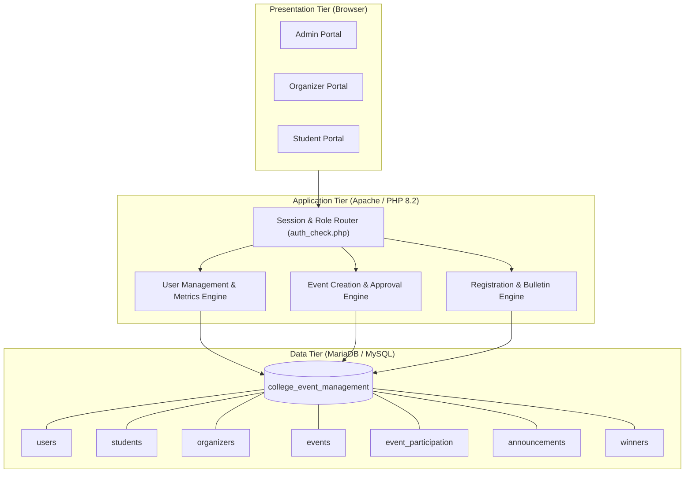
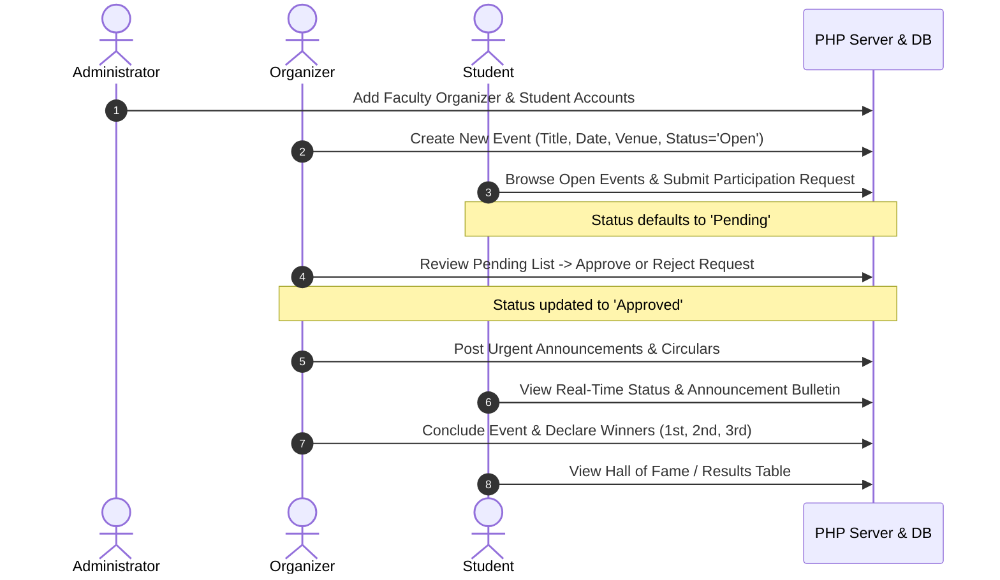
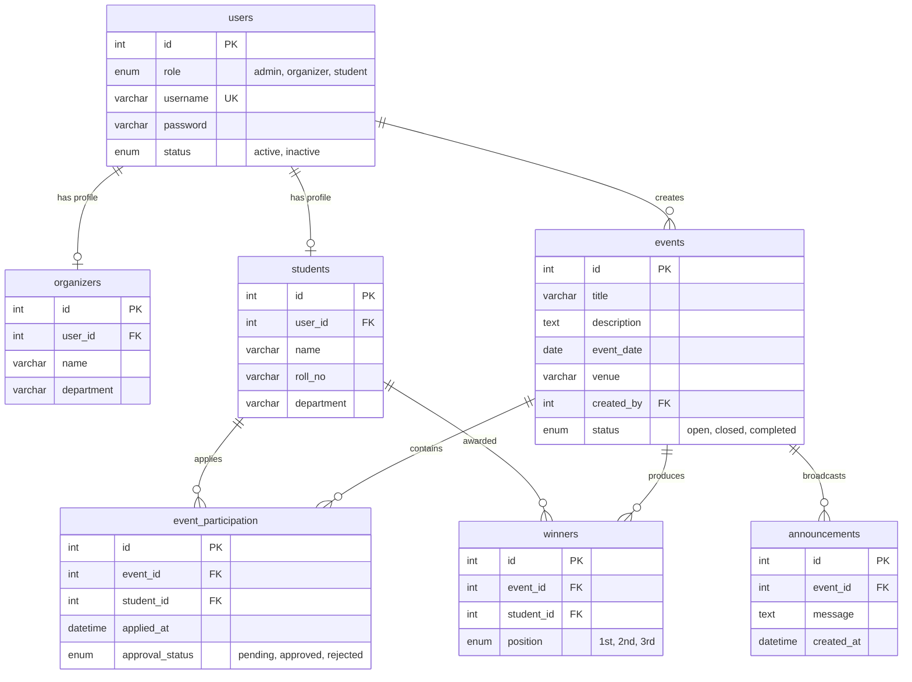

# 📄 College Event Management System — Project Report

---

## 📌 Executive Summary & Abstract

The **College Event Management System (CEMS)** is a web-based institutional application designed to simplify, automate, and centralize the planning, execution, and tracking of campus events, technical symposiums, cultural fests, and sports competitions. 

Traditionally, college events rely on fragmented communication channels—paper circulars, physical noticeboards, manual registration forms, and manual spreadsheets. This leads to bottlenecks such as untracked student participation, delayed approval workflows, miscommunication of schedule changes, and error-prone winner record-keeping.

The **College Event Management System** bridges these operational gaps by providing a unified, multi-tiered platform with dedicated portals for **Administrators**, **Event Organizers (Faculty/Student Leads)**, and **Students**.

---

## 🎯 Objectives & Scope

### 1. Key Objectives
* **Centralized Data Management**: Eliminate physical registration slips by storing all student enrollments, faculty organizers, and event records in a relational database.
* **Role-Based Workflow Automation**: Provide strict segregation of duties between system governance (Admin), event lifecycle handling (Organizer), and participation (Student).
* **Transparent Participation Lifecycle**: Give students real-time feedback on their event applications with verifiable status indicators (`Pending`, `Approved`, `Rejected`).
* **Digital Noticeboard & Hall of Fame**: Instantaneous broadcast of urgent notifications and official podium rankings.

### 2. Project Scope
* **Institutional Boundaries**: Suited for engineering, arts, and science colleges with multiple departments (Computer Science, Information Technology, Mechanical, etc.).
* **Operational Scale**: Capable of handling concurrent student registrations across multiple concurrent events during annual college fests.

---

## 🏗️ System Architecture & Workflow

The application follows a **3-Tier Web Architecture** combining a presentation tier (HTML5/Bootstrap), a server application tier (PHP 8.2), and a relational data tier (MariaDB/MySQL).



---

## 🔄 Role-Based Operational Workflows



---

## 🗄️ Database Schema & Entity-Relationship Design

The relational database `college_event_management` consists of 7 normalized tables enforcing referential integrity via foreign key constraints with cascading deletes (`ON DELETE CASCADE`).



---

### Detailed Table Specifications

#### 1. `users` Table
Stores credential and authentication data for all system actors.

| Column | Data Type | Constraints | Description |
| :--- | :--- | :--- | :--- |
| `id` | `INT(11)` | `PRIMARY KEY`, `AUTO_INCREMENT` | Unique identifier for system user |
| `role` | `ENUM` | `'admin', 'organizer', 'student'`, `NOT NULL` | Access control role |
| `username` | `VARCHAR(50)` | `UNIQUE`, `NOT NULL` | System login username |
| `password` | `VARCHAR(255)` | `NOT NULL` | User password |
| `status` | `ENUM` | `'active', 'inactive'`, `DEFAULT 'active'` | Account activation state |

#### 2. `students` Table
Stores demographic and academic profile details mapped to a `user_id`.

| Column | Data Type | Constraints | Description |
| :--- | :--- | :--- | :--- |
| `id` | `INT(11)` | `PRIMARY KEY`, `AUTO_INCREMENT` | Internal student identifier |
| `user_id` | `INT(11)` | `FOREIGN KEY (users.id)`, `CASCADE` | Link to authentication record |
| `name` | `VARCHAR(100)` | `NOT NULL` | Full student name |
| `roll_no` | `VARCHAR(50)` | Nullable | College roll / enrollment number |
| `department` | `VARCHAR(100)` | Nullable | Academic department |

#### 3. `organizers` Table
Stores faculty coordinators or student leads managing events.

| Column | Data Type | Constraints | Description |
| :--- | :--- | :--- | :--- |
| `id` | `INT(11)` | `PRIMARY KEY`, `AUTO_INCREMENT` | Internal organizer identifier |
| `user_id` | `INT(11)` | `FOREIGN KEY (users.id)`, `CASCADE` | Link to authentication record |
| `name` | `VARCHAR(100)` | `NOT NULL` | Organizer full name |
| `department` | `VARCHAR(100)` | Nullable | Associated department |

#### 4. `events` Table
Stores all event scheduling, logistical details, and current lifecycle status.

| Column | Data Type | Constraints | Description |
| :--- | :--- | :--- | :--- |
| `id` | `INT(11)` | `PRIMARY KEY`, `AUTO_INCREMENT` | Event identifier |
| `title` | `VARCHAR(150)` | `NOT NULL` | Event headline / title |
| `description` | `TEXT` | Nullable | Event rules, agenda, details |
| `event_date` | `DATE` | `NOT NULL` | Date of competition / event |
| `venue` | `VARCHAR(100)` | Nullable | Room, hall, ground location |
| `created_by` | `INT(11)` | `FOREIGN KEY (users.id)`, `CASCADE` | User who created the event |
| `status` | `ENUM` | `'open', 'closed', 'completed'`, `DEFAULT 'open'` | Registration availability status |

#### 5. `event_participation` Table
Represents application transactions, preventing duplicate registrations through composite uniqueness.

| Column | Data Type | Constraints | Description |
| :--- | :--- | :--- | :--- |
| `id` | `INT(11)` | `PRIMARY KEY`, `AUTO_INCREMENT` | Registration record ID |
| `event_id` | `INT(11)` | `FOREIGN KEY (events.id)`, `CASCADE` | Event reference |
| `student_id` | `INT(11)` | `FOREIGN KEY (students.id)`, `CASCADE` | Student reference |
| `applied_at` | `DATETIME` | `DEFAULT CURRENT_TIMESTAMP` | Timestamp of application |
| `approval_status`| `ENUM` | `'pending', 'approved', 'rejected'` | Coordinator evaluation status |

> [!NOTE]
> Composite unique constraint `UNIQUE (event_id, student_id)` prevents a student from applying to the same event multiple times.

#### 6. `winners` Table
Maintains official prize rankings per event.

| Column | Data Type | Constraints | Description |
| :--- | :--- | :--- | :--- |
| `id` | `INT(11)` | `PRIMARY KEY`, `AUTO_INCREMENT` | Winner record ID |
| `event_id` | `INT(11)` | `FOREIGN KEY (events.id)`, `CASCADE` | Associated event |
| `student_id` | `INT(11)` | `FOREIGN KEY (students.id)`, `CASCADE` | Victorious student |
| `position` | `ENUM` | `'1st', '2nd', '3rd'`, `NOT NULL` | Podium rank |

#### 7. `announcements` Table
Stores public alerts and circulars associated with events.

| Column | Data Type | Constraints | Description |
| :--- | :--- | :--- | :--- |
| `id` | `INT(11)` | `PRIMARY KEY`, `AUTO_INCREMENT` | Announcement ID |
| `event_id` | `INT(11)` | `FOREIGN KEY (events.id)`, `CASCADE` | Event reference |
| `message` | `TEXT` | `NOT NULL` | Notice broadcast message |
| `created_at` | `DATETIME` | `DEFAULT CURRENT_TIMESTAMP` | Timestamp of broadcast |

---

## 💻 Module Breakdown & Implementation Details

### 1. Authentication & Session Module (`login.php`, `logout.php`, `auth_check.php`)
* Implements stateful sessions via PHP `session_start()`.
* Routes users upon successful authentication directly to their role-specific landing page:
  * Role `admin` ➔ [`admin_dashboard.php`](file:///c:/Users/radhika/Downloads/projects/College%20Event-20261012T171641Z-1-001/admin_dashboard.php)
  * Role `organizer` ➔ [`organizer_dashboard.php`](file:///c:/Users/radhika/Downloads/projects/College%20Event-20261012T171641Z-1-001/organizer_dashboard.php)
  * Role `student` ➔ [`student_dashboard.php`](file:///c:/Users/radhika/Downloads/projects/College%20Event-20261012T171641Z-1-001/student_dashboard.php)
* Protects private routes by enforcing non-null session checks (`$_SESSION['user_id']`).

### 2. Admin Module (`admin_dashboard.php`, `add_student.php`, `add_organizer.php`)
* **Live System Metrics**: Computes aggregate statistics using SQL queries:
  $$\text{Total Users}, \quad \text{Students Count}, \quad \text{Organizers Count}, \quad \text{Open Events}, \quad \text{Total Participations}$$
* **Onboarding Forms**: Atomic creation of dual records (inserting into `users`, followed by corresponding `students` or `organizers` record with foreign key association).

### 3. Organizer Module (`create_event.php`, `manage_participants.php`, `declare_winner.php`, `post_announcement.php`)
* **Event Creation**: Form allowing organizers to schedule events with title, description, date, and venue.
* **Participant Approval Workflow**: Review students who applied, with toggles to mark status as `approved` or `rejected`.
* **Winner Declaration**: Modal/form to assign 1st, 2nd, and 3rd place prizes to registered participants.
* **Announcements**: Broadcast urgent schedule updates.

### 4. Student Module (`student_dashboard.php`, `view_events.php`, `winners.php`, `announcements.php`)
* **Event Browsing & Application**: Filtered list of events with status indicator (`Apply` if unapplied, or badge displaying `Pending` / `Approved` / `Rejected`).
* **Bulletin Board**: Real-time broadcast list of notifications ordered chronologically by `created_at DESC`.
* **Results / Hall of Fame**: Color-coded badges for podium finishes (`1st` = Green, `2nd` = Yellow, `3rd` = Secondary).

---

## 🔒 Technical Evaluation & Security Audit

| Parameter | Current Implementation | Risk Level | Recommendation |
| :--- | :--- | :--- | :--- |
| **Password Storage** | Plain-text strings (`12345`) | 🔴 Critical | Migrate to Bcrypt hashing via `password_hash()` & `password_verify()`. |
| **SQL Query Safety** | String interpolation with `mysqli_real_escape_string` | 🟡 Moderate | Transition to Prepared Statements (`mysqli_stmt` or PDO) to eliminate SQL injection. |
| **CSRF Defense** | No CSRF tokens on forms | 🟡 Moderate | Embed randomized CSRF tokens in POST forms validated in session. |
| **Public Landing** | Direct redirect to login card | 🔵 UI/UX | Introduce public landing page (`index.php`) showcasing the fest. |
| **Data Export** | Browser tables only | 🔵 Feature | Add CSV/Excel export for participant lists. |

---

## ⚙️ Environment & Technical Specifications

* **Operating System**: Windows 11 / Windows Server
* **Web Server**: Apache HTTP Server 2.4.58
* **PHP Engine**: PHP 8.2.12 (Thread-Safe, x64)
* **Database Engine**: MariaDB 10.4.32 / MySQL Relational Database
* **Database Driver**: Procedural MySQLi extension (`php_mysqli.dll`)
* **Frontend Framework**: Bootstrap 5.3.2, Bootstrap Icons 1.11.0
* **Version Control**: Git 2.56.0, GitHub CLI 2.102.0
* **Repository**: [https://github.com/radhikaahire/college-event-](https://github.com/radhikaahire/college-event-)

---

## 🚀 Future Roadmap & Enhancement Recommendations

```
[Phase 1: Public Face] ───> [Phase 2: Analytics & Exports] ───> [Phase 3: QR & E-Passes]
```

1. **Digital E-Tickets with Scannable QR Codes**:
   Generate downloadable PDF passes for approved participants containing a secure verification QR code.
2. **On-Site QR Attendance Check-In**:
   Enable coordinators to scan participant passes using laptop webcams or mobile cameras to log attendance in real time.
3. **Automated Certificate Generation**:
   Dynamically render official certificates of participation and merit as downloadable PDFs.
4. **Team Registration Support**:
   Enable team leaders to register multiple teammates for group competitions (Hackathons, Dance, Sports).
5. **Interactive Chart.js Analytics**:
   Replace static metric numbers on the Admin dashboard with departmental breakdown charts and registration trend graphs.

---

## 🏁 Conclusion

The **College Event Management System** provides a solid, working foundation for automating institutional event logistics. With its robust relational database schema and clear role-based architecture, the platform effectively eliminates manual paper workflows. Implementing the suggested visual enhancements, security hardenings, and QR-ticketing features will elevate this project to an industry-grade campus management solution.
